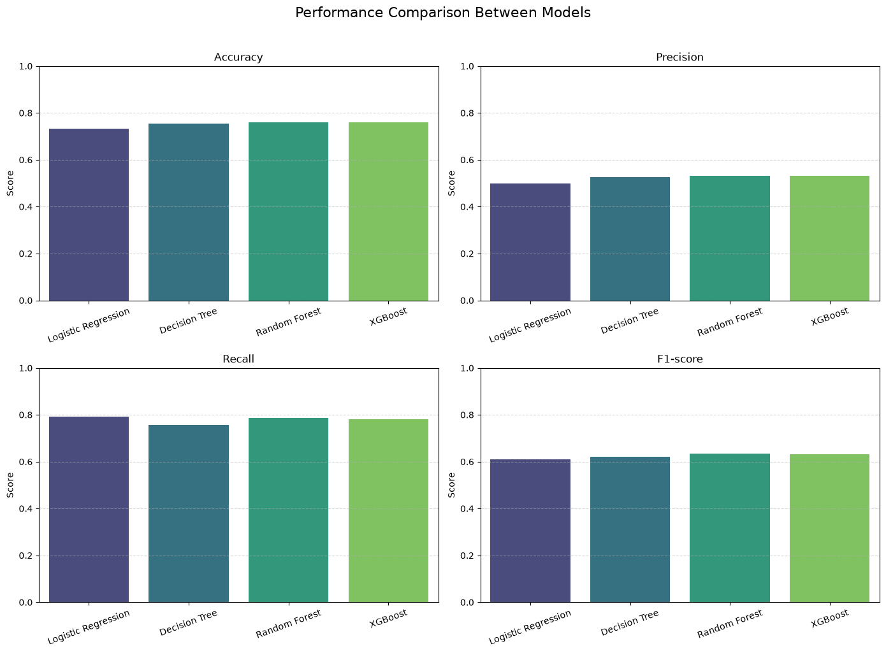

# Customer Churn Prediction

Predicts whether a telecom customer will churn using supervised machine learning on the **Telco Customer Churn** dataset (7,043 customers, 21 features).

---

## Project Structure

```
customer-churn-project/
├── churn_analysis.ipynb       # Main notebook
└── Telco-Customer-Churn.csv   # Dataset
customer_churn_results.png     # Model comparison chart
```

---

## Workflow

1. **EDA** — Churn distribution, contract type, tenure group, payment method, and internet service analysis
2. **Preprocessing** — Label encoding, numeric conversion, tenure grouping, train/test split (80/20, stratified)
3. **Feature Engineering** — `StandardScaler` for numeric features, `OneHotEncoder` for categorical (via `ColumnTransformer`)
4. **Modeling** — Four classifiers trained with `class_weight="balanced"` to handle class imbalance (~73% no-churn / ~27% churn)
5. **Evaluation** — Accuracy, Precision, Recall, F1-score

---

## Models & Results

| Model               | Accuracy | Precision | Recall | F1-score |
|---------------------|----------|-----------|--------|----------|
| Logistic Regression | 0.7339   | 0.4992    | 0.7941 | 0.6130   |
| Decision Tree       | 0.7551   | 0.5270    | 0.7567 | 0.6213   |
| Random Forest       | 0.7594   | 0.5316    | 0.7861 | 0.6343   |
| **XGBoost**         | **0.7594** | **0.5319** | 0.7807 | **0.6327** |

> **Random Forest** and **XGBoost** tied on accuracy and delivered the best overall balance of precision, recall, and F1.



---

## Key Findings

- **Month-to-month contracts** have the highest churn rate (~43%)
- **Electronic check** payment users churn at ~45%
- **Fiber optic** internet users churn at ~42%
- Customers with **tenure < 12 months** churn at ~48%

---

## Tech Stack

- **Python** — pandas, numpy, scikit-learn, XGBoost, matplotlib, seaborn
