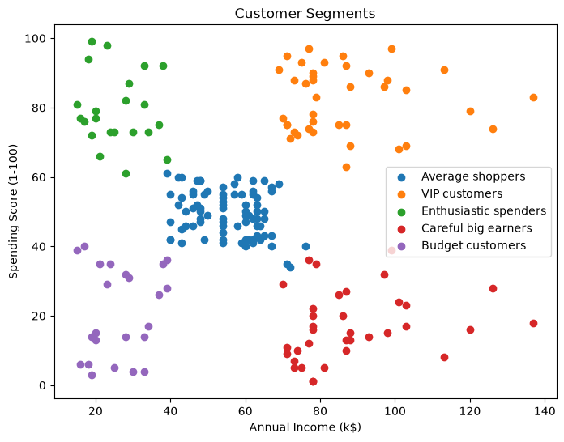
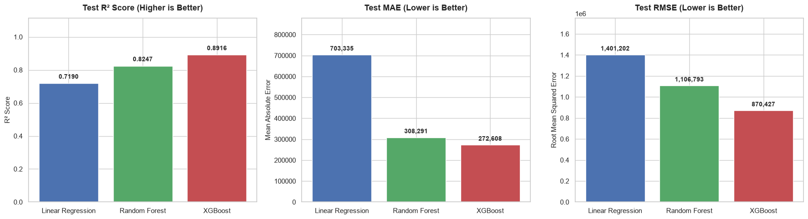

# Machine Learning Projects

This repository contains machine learning projects for customer segmentation, customer churn prediction, and used car price prediction.

---

## Customer Segmentation

Groups mall customers into five segments using K-Means clustering, based on annual income and spending score. The notebook scales these features, compares cluster counts with the elbow method and silhouette scores, then fits and visualizes the five-cluster model.

Project files: `Mall Customer Segmentation/clustering_model.ipynb` and `Mall Customer Segmentation/Mall_Customers.csv`.

---

## Customer Churn Prediction

Predicts whether a telecom customer will churn using supervised machine learning on the **Telco Customer Churn** dataset (7,043 customers, 21 features).

### Workflow

1. **EDA** — Churn distribution, contract type, tenure group, payment method, and internet service analysis
2. **Preprocessing** — Label encoding, numeric conversion, tenure grouping, train/test split (80/20, stratified)
3. **Feature Engineering** — `StandardScaler` for numeric features, `OneHotEncoder` for categorical (via `ColumnTransformer`)
4. **Modeling** — Four classifiers trained with `class_weight="balanced"` to handle class imbalance (~73% no-churn / ~27% churn)
5. **Evaluation** — Accuracy, Precision, Recall, F1-score

### Models & Results

| Model               | Accuracy | Precision | Recall | F1-score |
|---------------------|----------|-----------|--------|----------|
| Logistic Regression | 0.7339   | 0.4992    | 0.7941 | 0.6130   |
| Decision Tree       | 0.7551   | 0.5270    | 0.7567 | 0.6213   |
| Random Forest       | 0.7594   | 0.5316    | 0.7861 | 0.6343   |
| **XGBoost**         | **0.7594** | **0.5319** | 0.7807 | **0.6327** |

> **Random Forest** and **XGBoost** tied on accuracy and delivered the best overall balance of precision, recall, and F1.

### Key Findings

- **Month-to-month contracts** have the highest churn rate (~43%)
- **Electronic check** payment users churn at ~45%
- **Fiber optic** internet users churn at ~42%
- Customers with **tenure < 12 months** churn at ~48%

Project files: `customer-churn-project/churn_analysis.ipynb` and `customer-churn-project/Telco-Customer-Churn.csv`.

---

## Used Car Price Prediction

Predicts used car prices with a tuned XGBoost regression model. The workflow converts engine and power specifications to numeric values, creates car age and size features, imputes missing values, and encodes categorical features. It uses a held-out test set and randomized three-fold cross-validation for model selection.

### Test Results

| Metric | Result |
|--------|-------:|
| Mean Absolute Error (MAE) | 270,126.84 |
| Root Mean Squared Error (RMSE) | 931,359.07 |
| R² score | 0.8758 |

The results plot shows actual versus predicted prices, the test residual distribution, and residuals by actual price.

Project files: `used_car_prediction/car_predict.ipynb` and `used_car_prediction/car details v4.csv`.
